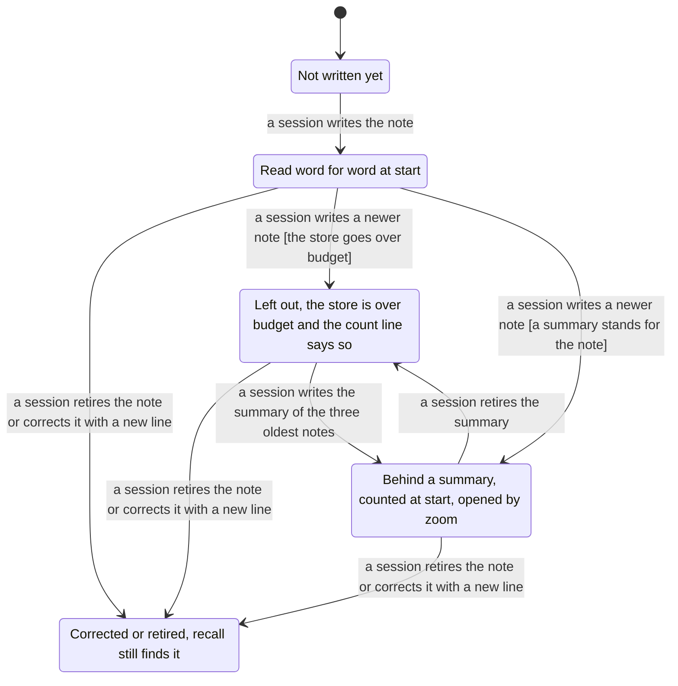

# The checked model

A TLA+ model of one scope's store, checked with TLC through the `statechart` skill. It covers what moves between states in the design: a note's life, the start read's selection under the budget, and the exchange of files between machines. The files are in [model/](model/).

| File | What it is |
| :-- | :-- |
| [model/memo.tla](model/memo.tla) | The model |
| [model/life.cfg](model/life.cfg), [model/life-view.ts](model/life-view.ts) | One machine, six notes, two summaries. Small enough to draw |
| [model/merge.cfg](model/merge.cfg) | Two machines, five notes, four summaries, one of them written by the other machine across two others |
| [model/bookmark.cfg](model/bookmark.cfg) | The same two machines, which exchange files only through one `memo` bookmark |
| [model/today.cfg](model/today.cfg), [model/merge-view.ts](model/merge-view.ts) | The same two machines with today's rule for which summaries are in effect |
| `model/*-report.md`, `model/*-chart.mmd` | What the runs printed |

## What the model says

A store is a set of files that only grows. Sessions do four things to it: write a note, write a summary (a compaction task's answer), correct a note with a new one, and retire a note or a summary. Machines exchange files in one of two ways. In the first, a machine receives every file of another machine. No part of the design does that directly any more, and the two configs that use it keep it as the plain union that a fetch and a push add up to, and as the way the replay on today's `scripts/memo` copied files. In the second, a machine fetches a bookmark's files and pushes its own, and the bookmark takes a push only from a machine that already holds every file of the bookmark. That is the `memo` bookmark that carries every store in the design, which no machine pushes by force. After each step, each machine's start read is computed again from its files, by the selection of [design.md](design.md).

The second revision changed two things in the model. The third revision moved the machine, group and user stores to a bookmark, which changes no rule: `bookmark.cfg` already checks that exchange. Only comments in the model changed, and the four configs ran again with the same results. The selection for a store over its slice now drops the oldest notes outside a summary first, with the new rule `KeptNotesStay`. The bookmark is new, with the new rule `SettledMeansEqual`.

## The rules

Each rule is an invariant of the model, in the words a reader would agree to.

| Rule | In words |
| :-- | :-- |
| `WithinBudget` | The start read of a scope never holds more lines than its slice |
| `OnlyLiveNotes` | Every line read word for word is a live note of the store: nothing corrected, retired or rewritten |
| `NeverTwice` | No live note is told twice: two summaries shown together never stand for the same note, and a summary shown never stands for a note that is also shown on its own |
| `Accounted` | A live note is read, or counted by one summary shown, or left out only while the store is over budget, when the count line says so |
| `NewestWordForWord` | The newest live note is always read word for word |
| `KeptNotesStay` | While a store is over its slice, a note outside a summary is read beyond the newest quarter of the slice only when every summary is shown. A note that a summary keeps never leaves to make room for a note outside a summary |
| `NoBrokenSummary` | A summary shown is not retired and still has every summary it was written from |
| `WriteNeverRefused` | While a note is left to write, every machine can add it: no state refuses a write for space |
| `SameFilesSameRead` | Two machines that hold the same files read the same lines |
| `SettledMeansEqual` | When nothing is left to do, every machine and every bookmark holds the same files. A refused push is followed by a fetch and a push that gets through |
| `FilesOnlyGrow` | No step removes a file, from a machine or from a bookmark |
| `NoDeadlock` | The model stops only when nothing is left to write, summarize, retire or exchange |

## Results

Run again on 2026-11-16 with TLC 2.19, after the two changes.

| Config | States | Result |
| :-- | :-- | :-- |
| `life.cfg` | 33 | Every rule holds |
| `merge.cfg` | 7,776 | Every rule holds |
| `bookmark.cfg` | 52,491 | Every rule holds |
| `today.cfg` | 7,776 | `NeverTwice` breaks in 11 steps. Every other rule holds |

`KeptNotesStay` was also run against the first revision's selection, which showed the newest lines that fit. It breaks there in 7 steps of `life.cfg`: a session writes four notes, a summary of the three oldest that keeps one, and two more notes. The store goes over its slice, and the read drops the summary with its kept note while it still shows three notes outside a summary. So the rule tests the change.

### A note's life

The chart follows the oldest note of `life.cfg` in a slice of 4 lines. One summary covers the three oldest notes and keeps another one of them. A higher summary covers that summary and the fourth note. In [model/life-chart.mmd](model/life-chart.mmd), teal states are inside the budget and the orange state is over it. The state "Behind a summary" has no color, because the note can be there in both cases.



The chart does not draw the 30 steps that leave the note where it is, such as a newer note written while the cover still fits. Its view hides the 3 steps of the end states, where nothing is left to do. A note that a summary keeps stays in "Read word for word at start" for as long as the summary is shown.

The first revision had two more arrows. A newer note could push a note from "Behind a summary" to "Left out", and a higher summary could bring it back. With the new selection the summary stays in the read when the store goes over its slice, so only retiring the summary takes the note from behind it.

### Today's rule tells notes twice after a merge

memo today picks the summaries in effect by how many ids each covers directly, the older id first on a tie. Under that rule the model reaches a start read that tells a note twice:

1. A session on machine A writes notes 1 to 4, and machine B receives them.
2. A session on A writes summary 10 of notes 2 and 3.
3. A session on B writes summary 11 of notes 1 and 2, corrects note 2 with note 5, writes summary 12 of notes 3 and 4, and writes summary 21 of summaries 11 and 12.
4. B receives the files of A.

Summary 10 is the oldest, so it wins over 11 and 12. Summary 21 covers 11 and 12, which no summary in effect claims, so it stays in effect too. Machine B then reads note 3 on its own (under the opened summary 10) and counts it again under summary 21. The full path is in [model/today-report.md](model/today-report.md).

The path was replayed against today's `scripts/memo` in two temporary home folders: four notes on A, copied to B, a summary of notes 2 and 3 on A, the three summaries on B, then A's summary file copied to B. `memo wake --full` on B printed both summaries and notes 1 and 4 beside them. The defect is real and has not shown, because no store is merged between machines today.

v2's rule takes the summary that stands for the most notes first, and a summary in effect claims every note under it. With that rule (`merge.cfg`) every rule holds over the same 7,776 states.

### The bookmark

`bookmark.cfg` gives the two machines of `merge.cfg` one bookmark and no other way to exchange files. A push is possible only from a machine that holds every file of the bookmark, as a push without force is. Every rule holds over 52,491 states. Two results matter for the sync of [design.md](design.md). `FilesOnlyGrow` holds for the bookmark, so no order of fetches and pushes loses a file there. `SettledMeansEqual` holds, so the refused push of a machine that fetched too early never leaves a file on one machine for good.

## What the model leaves out

- Bytes. The model counts lines: a note costs one, and a summary costs one for each live note it keeps and one for its count. The byte arithmetic is a property test in [sketch.md](sketch.md).
- More than one scope. The scopes share nothing, so one store is enough. The dotfiles' bookmark carries several stores as separate folders, and each behaves as the one store here.
- The size of a group and the rule for which group a task offers. A summary in the model is one of a fixed few.
- Clock skew. A newer note always has a larger id.
- The admission rule, the advice at write time and the refusal for length or a secret. They change no state of the store.
- Git itself. The model's exchange is the union that the sync produces. The tests of [sketch.md](sketch.md) run the real git steps against a bare repository.
- A fetch or a push that fails. A failed step changes no file, so it is a step that did not happen.
- The newest quarter of a slice is one line in the model, because the slice is 4 lines.

## Run it again

```sh
skills/engineering/statechart/scripts/statechart docs/design/memo-v2/model/memo.tla \
  --config docs/design/memo-v2/model/life.cfg --view docs/design/memo-v2/model/life-view.ts --out <new folder>
skills/engineering/statechart/scripts/statechart docs/design/memo-v2/model/memo.tla \
  --config docs/design/memo-v2/model/merge.cfg --out <new folder>
skills/engineering/statechart/scripts/statechart docs/design/memo-v2/model/memo.tla \
  --config docs/design/memo-v2/model/bookmark.cfg --out <new folder>
skills/engineering/statechart/scripts/statechart docs/design/memo-v2/model/memo.tla \
  --config docs/design/memo-v2/model/today.cfg --view docs/design/memo-v2/model/merge-view.ts --out <new folder>
```

The last command exits 1, because a rule breaks. The run of `bookmark.cfg` takes about 16 seconds.
